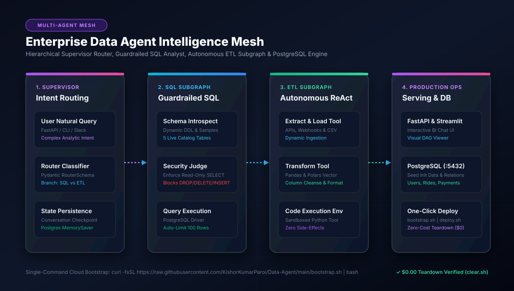

# 🤖 Enterprise Data Agent Intelligence Mesh - Architecture Blueprint

[](docs/images/01_architecture_flow.svg)

---

## ⚡ Zero-Touch Cloud Bootstrap & Teardown

```bash
# 🚀 1. One-Click Cloud Bootstrap (EC2 / Ubuntu / macOS)
curl -fsSL https://raw.githubusercontent.com/KishorKumarParoi/Data-Agent/main/bootstrap.sh | bash

# 🛑 2. Zero-Cost Teardown ($0.00 Spend)
./clear.sh
```

---

## Executive Summary

The **Enterprise Data Agent Intelligence Mesh** is an autonomous multi-agent decision support platform combining hierarchical routing, self-reflective SQL query generation with security gating, and automated ETL transformation pipelines. Built according to the **Enterprise AI Architect Roadmap (Phases 0 - 5)**, this system operates with **LangGraph**, **PostgreSQL**, and containerized multi-agent execution.

---

## 1. Architectural System Design

```
+----------------------------------------------------------------------------------------------------+
|                                    MULTI-AGENT SYSTEM FLOW                                         |
+----------------------------------------------------------------------------------------------------+

 [ User Input ] ------------> [ Supervisor / Router Agent ]
                                     |
             +-----------------------+-----------------------+
             |                                               |
             v                                               v
  [ SQL Analyst Subgraph ]                        [ ETL Analyst Subgraph ]
   1. Curate Natural Question                      1. Tool Calling Loop (ReAct)
   2. Schema Introspection                         2. extract_load_tool (APIs/CSV)
   3. Generate SQL Query                           3. transform_load_tool (Pandas)
   4. Security Judge Gate (Enforce SELECT)         4. execute_code_tool (Sandbox)
   5. PostgreSQL Execution (:5432)                 5. Summarize Pipeline Output
   6. Executive Markdown Synthesis                           |
             |                                               |
             +-----------------------+-----------------------+
                                     |
                                     v
                        [ Final Stakeholder Response ]
```

---

## 2. Enterprise AI Architect Roadmap Alignment (Phases 0 - 5)

### Phase 0: Environment Setup, SLOs & Engineering Rigor
- **Target SLOs**:
  - Routing Latency: `< 450ms`
  - SQL Generation + Security Judge: `< 1.2s`
  - Query Execution: `< 100ms` (indexed PostgreSQL tables)
- **Containerization**: Python 3.11-slim container paired with PostgreSQL 15 Alpine in unified Docker Compose.

### Phase 1: Algorithmic & Agent State Graph Foundations
The system implements a **Hierarchical StateGraph** with conditional edges:

```python
class AgentState(TypedDict):
    messages: Annotated[list[BaseMessage], operator.add]
    intent: Literal["sql", "etl"]
    curated_query: str
    generated_sql: str
    is_safe: bool
    query_results: list[dict]
    final_response: str
```

The router dynamically delegates control based on intent classification evaluated via structured output (`RouterSchema`).

### Phase 2: Data & MLOps Pipelines
- **Automated Catalog Introspection**: Queries PostgreSQL information schema for table metadata, column constraints, and foreign key relations.
- **Automated Data Seeding**: Seeds 5 realistic relational tables (`users`, `vehicles`, `rides`, `payments`, `ratings`) on startup.
- **Autonomous ETL Pipelines**: Tool calling ReAct agent handles file downloads, schema standardization, and data cleansing.

### Phase 3: Production Serving & Interactive Interface
- **FastAPI Core (`main.py`)**:
  - `POST /query`: Dispatches multi-agent workflow and returns structured results.
  - `GET /health`: Readiness and liveness check.
  - `GET /metrics`: Prometheus telemetry counter.
- **Streamlit Portal**: Real-time visualization of agent thought processes, generated SQL queries, and interactive dataframes.

### Phase 4: Scalable Cloud Architecture
- **Unified Deployment (`deploy.sh`)**: Multi-mode launcher with `--compose`, `--quick`, and `--host`.
- **Zero-Cost Teardown (`clear.sh`)**: Eliminates all running containers, networks, and databases ($0.00 spend).
- **Cloud Bootstrapper (`bootstrap.sh`)**: Zero-touch installation on any fresh cloud VM.

### Phase 5: Security Judge & Governance
- **SQL Security Guardrail**:
  - Independent LLM security judge parses queries for destructive DDL/DML keywords (`DROP`, `TRUNCATE`, `ALTER`, `DELETE`, `UPDATE`, `INSERT`).
  - Queries failing the read-only check are intercepted and blocked prior to database transmission.
  - Automatic `LIMIT 100` appended to prevent memory exhaustion and large result set crashes.
